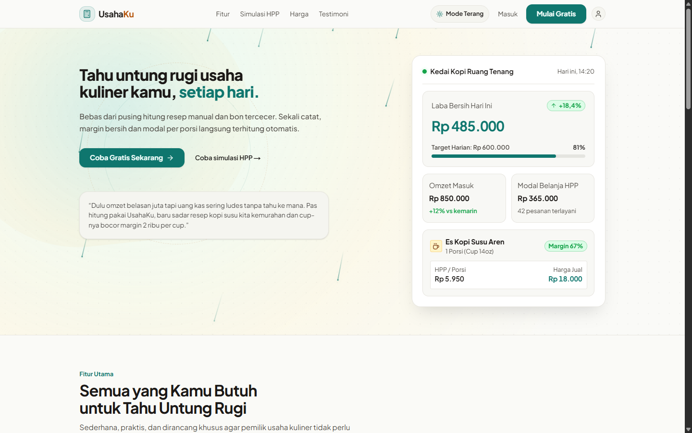
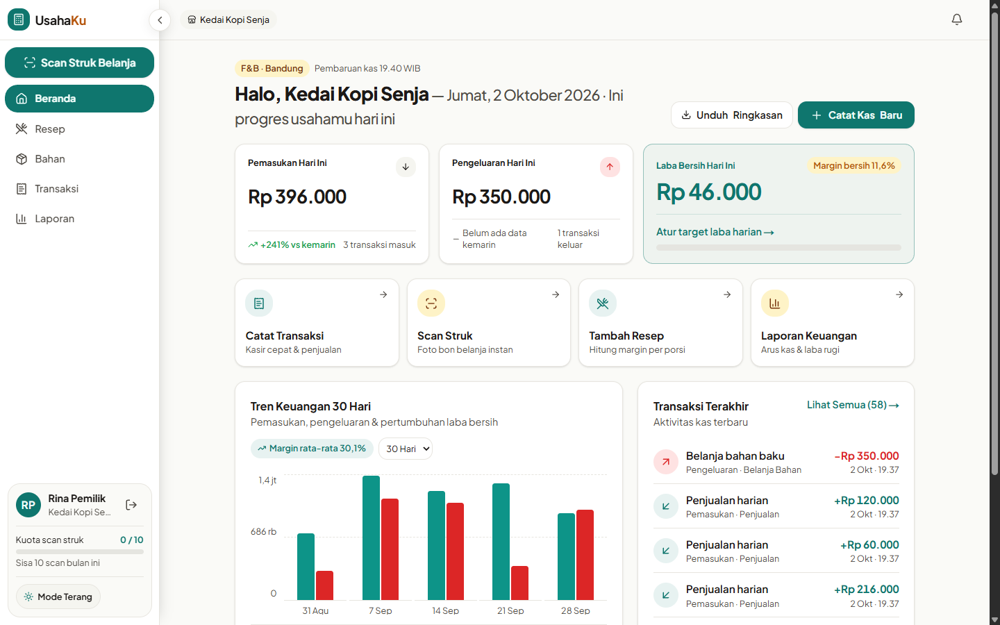
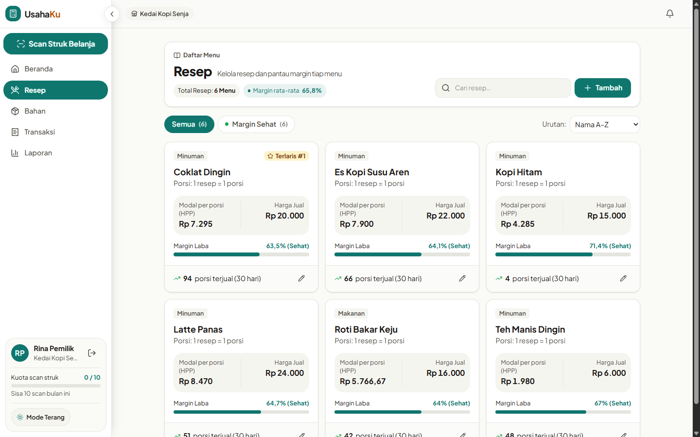
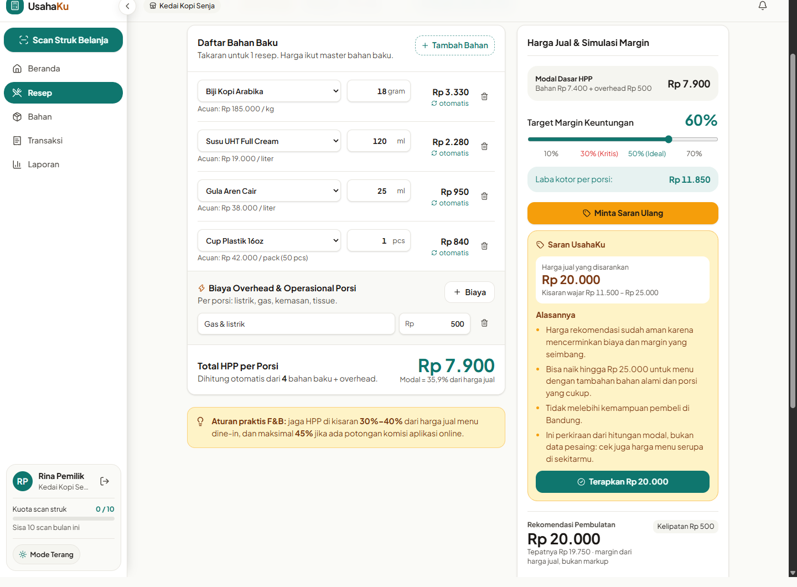
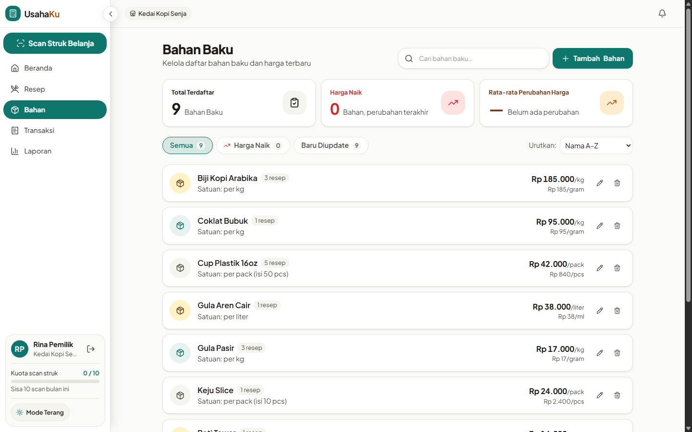
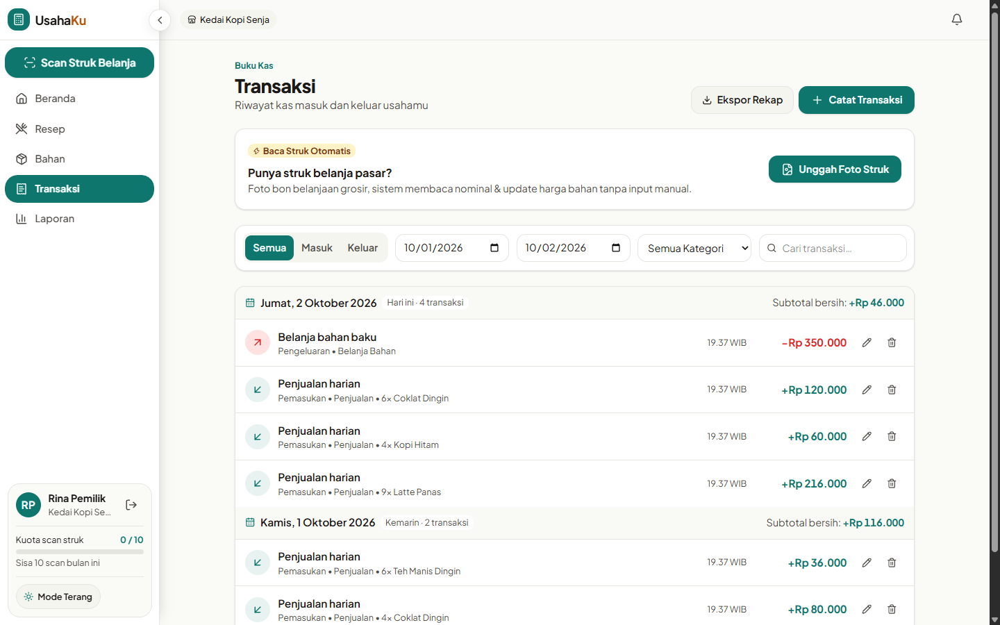
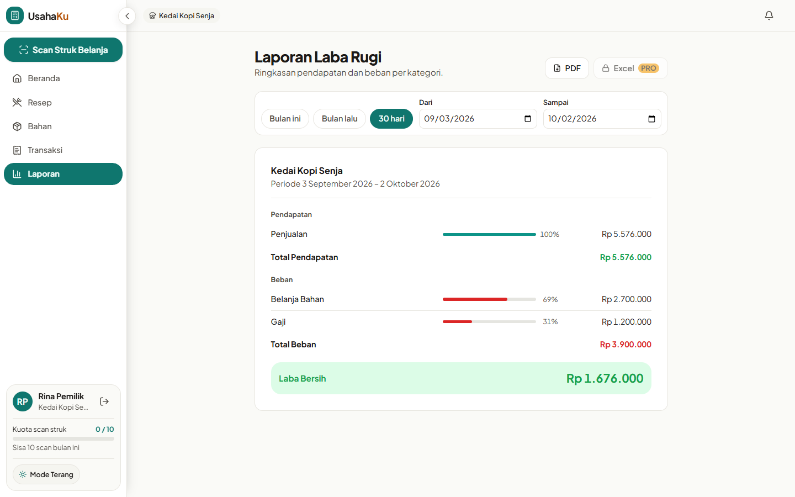
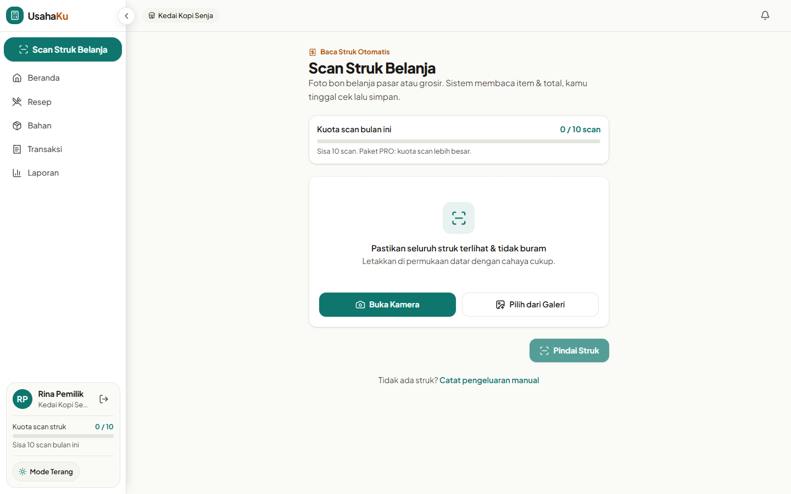
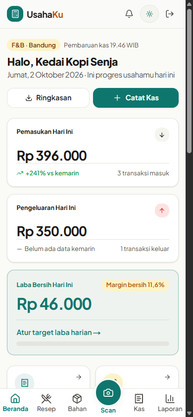
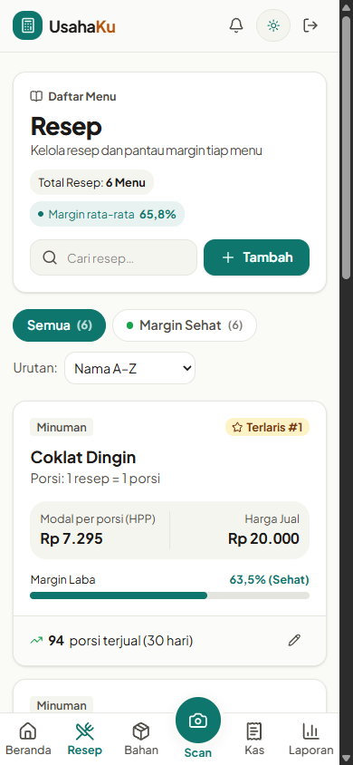

# UsahaKu

Kalkulator **HPP resep** dan **catatan kas** untuk UMKM kuliner (F&B). Hitung modal per porsi, pantau margin tiap menu, catat pemasukan dan pengeluaran, lalu lihat laba rugi usahamu tanpa ribet akuntansi.

<p align="center">
  
</p>

## Fitur

- **Kalkulator HPP live.** Pilih bahan dan takaran, modal per porsi dan margin langsung terhitung. Harga bahan di master otomatis memperbarui HPP semua resep yang memakainya.
- **Saran harga AI.** Harga rekomendasi dan batas bawah dihitung server dari HPP dan target margin. AI hanya menilai batas atas dan memberi alasan singkat, jadi angka utamanya tidak bergantung pada tebakan model.
- **Scan struk belanja.** Foto struk pasar atau grosir, sistem membaca item dan total, kamu tinggal cek lalu simpan. Harga bahan ikut diperbarui.
- **Buku kas.** Catat pemasukan dan pengeluaran per kategori. Penjualan bisa dikaitkan ke menu dan jumlah porsi untuk melihat menu terlaris.
- **Dashboard dan laporan.** Ringkasan harian, tren 30 hari, laporan laba rugi per periode (PDF; Excel untuk paket PRO).
- **Kuota paket.** FREE: 10 resep, 100 transaksi/bulan, 10 scan struk, 5 saran AI. PRO: batas lebih besar atau tanpa batas.
- **Ramah pengguna dewasa dan lansia.** Teks besar, bahasa sehari-hari, mode terang default, kontras jelas, dan nyaman di HP.

## Tampilan

| Beranda | Resep |
|---|---|
|  |  |

| Kalkulator HPP dan saran harga AI | Bahan baku |
|---|---|
|  |  |

| Transaksi | Laporan laba rugi |
|---|---|
|  |  |

| Scan struk | Di HP |
|---|---|
|  |   |

> Data pada gambar adalah data contoh ("Kedai Kopi Senja").

## Teknologi

| Lapisan | Pilihan |
|---|---|
| Frontend | Next.js 16 (App Router), React 19, TypeScript, Tailwind CSS v4, shadcn/ui, TanStack Query, React Hook Form + Zod |
| Backend | NestJS 12, Prisma 7, PostgreSQL, JWT di cookie httpOnly, class-validator |
| Antrean dan file | Redis + BullMQ (OCR struk), penyimpanan S3-compatible (SeaweedFS di dev) |
| AI | Vercel AI SDK + OpenRouter (atau Ollama untuk dev lokal) |
| Ops | Docker, GitHub Actions |

## Struktur repo

```
backend/   API NestJS (auth, resep/HPP, transaksi, laporan, OCR, AI)
frontend/  Aplikasi Next.js
docker/    docker-compose (Postgres, Redis, S3) dan Dockerfile
docs/      PRD.md, PRD.tasks.md (status task), docs/assets (gambar README)
design/    Referensi desain (Stitch)
```

## Menjalankan secara lokal

Butuh Node.js, pnpm, dan Docker.

```bash
# 1. Infrastruktur dev: Postgres, Redis, S3
docker compose -f docker/docker-compose.yml up -d

# 2. Backend (http://localhost:4000)
cd backend
cp .env.example .env          # isi JWT_SECRET (min. 32 karakter), lihat komentar di file
pnpm install                  # sekaligus prisma generate
pnpm prisma migrate dev --config prisma7.config.ts
pnpm start:dev

# 3. Frontend (http://localhost:3000), terminal lain
cd frontend
pnpm install
pnpm dev
```

Frontend memanggil API di `NEXT_PUBLIC_API_URL` (default `http://localhost:4000`).

### Mengaktifkan AI

Tanpa kunci, fitur AI mengembalikan 503 dan fitur lain tetap jalan. Pilih salah satu di `backend/.env`:

- **OpenRouter:** isi `OPENROUTER_API_KEY`. `OPENROUTER_MODEL` harus mendukung input gambar dan `structured_outputs`. Jangan pakai `openrouter/free` karena modelnya acak dan JSON bisa gagal.
- **Ollama (lokal):** set `OLLAMA_BASE_URL=http://localhost:11434/v1` dan `OLLAMA_MODEL`. Model teks cukup untuk saran harga; scan struk butuh model dengan kemampuan gambar.

## Pengujian

```bash
cd backend
pnpm lint && pnpm typecheck
pnpm test          # unit: hitungan HPP dan uang
pnpm test:e2e      # butuh Postgres, Redis, dan S3 jalan; matikan server dev backend dulu

cd ../frontend
pnpm lint
node node_modules/@typescript/native/bin/tsc --noEmit
node lib/hpp.check.mts   # cek hitungan HPP di sisi frontend
```

## Status

Backend, AI, dan integrasi frontend sudah selesai. Yang tersisa: halaman harga `/pricing`, modal upgrade saat kuota habis (402), deploy Coolify, dan halaman legal. Rincian per task ada di [`docs/PRD.tasks.md`](docs/PRD.tasks.md), spesifikasi produk di [`docs/PRD.md`](docs/PRD.md).
