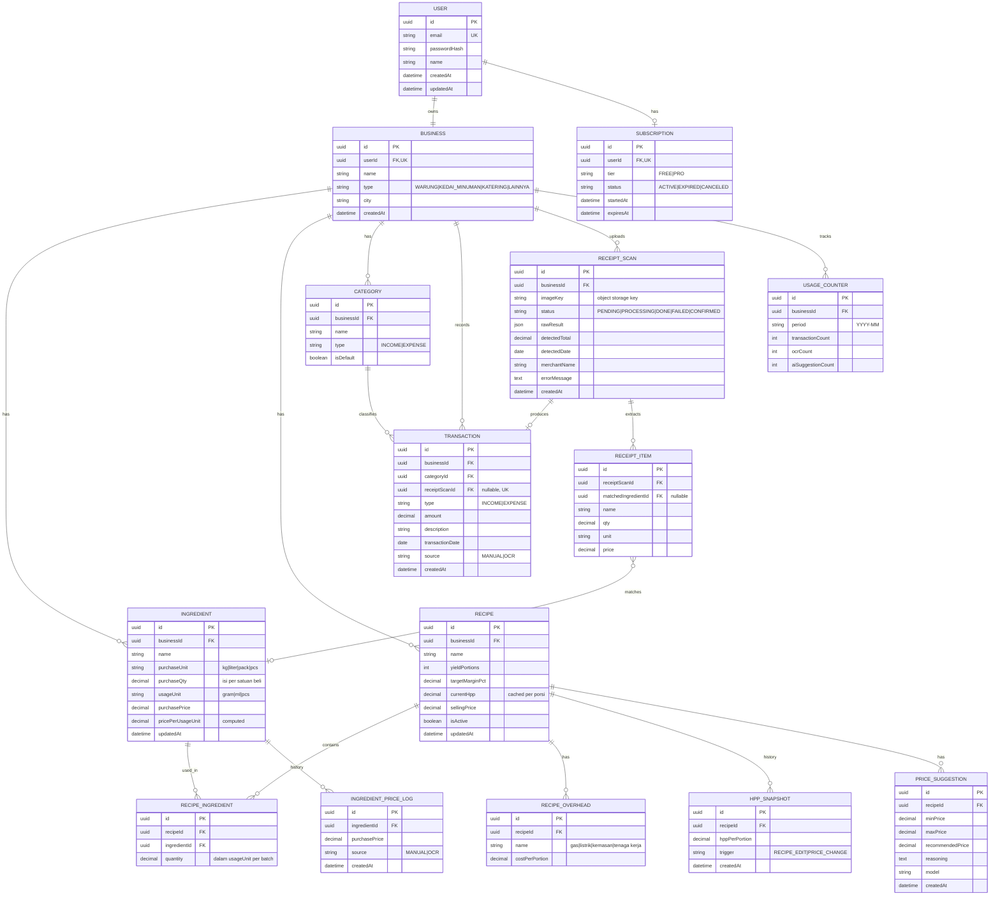
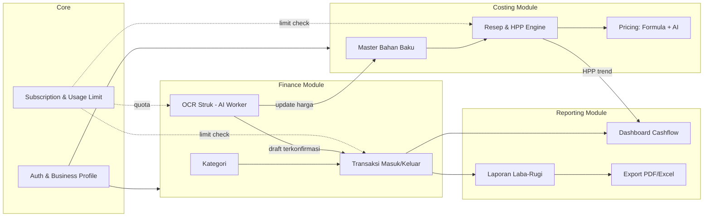
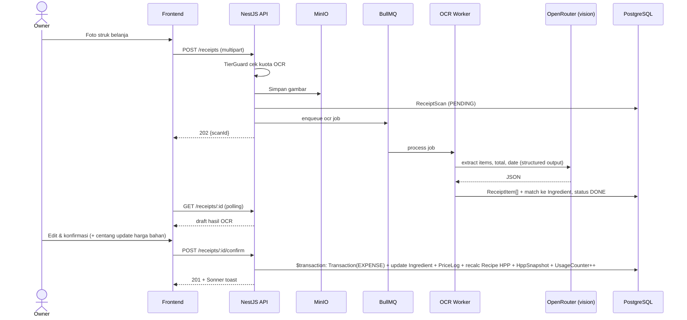
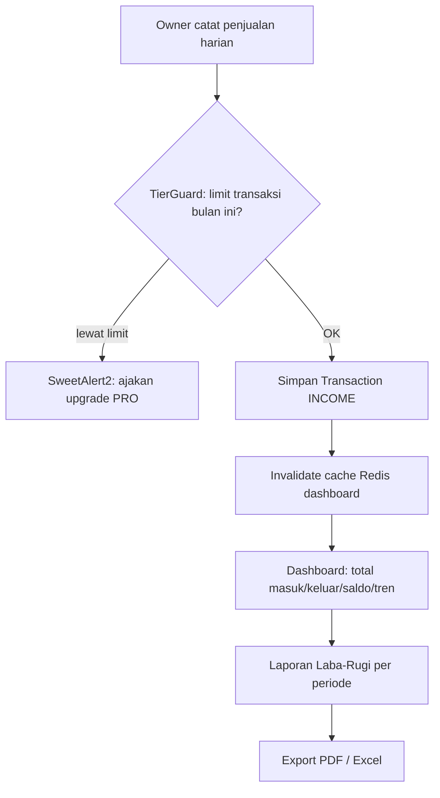

# Epic PRD: UsahaKu — SaaS HPP Calculator & Pencatatan Keuangan UMKM F&B

> Working title: **UsahaKu** · Path: `/docs/ways-of-work/plan/usahaku/epic.md`

## 0. Tech Stack

| Layer | Stack |
|---|---|
| Language | TypeScript 7 (native Go compiler) |
| Package manager | pnpm workspace (`frontend/` + `backend/`) |
| Frontend | Next.js 16 (Turbopack, `proxy.ts`), Tailwind CSS, shadcn/ui, Magic UI, Motion, Sonner, SweetAlert2 |
| State/Form | Zustand, TanStack Query v5, React Hook Form, Zod 4 |
| Backend | NestJS (ESM), pattern DTO / Service / Controller / Guard |
| Database | PostgreSQL + Prisma v7 (`provider = "prisma-client"`, `output = "../generated/prisma"`, `@prisma/adapter-pg`) |
| Cache/Queue | Redis (cache ringkasan dashboard + queue job OCR via BullMQ) |
| AI | OpenRouter (`@openrouter/ai-sdk-provider`) + Vercel AI SDK 6 — model vision untuk OCR |
| Auth | Custom JWT NestJS Guard |
| Storage | Object storage S3-compatible (MinIO self-hosted) untuk foto struk |
| DevOps | Docker, Docker Compose, Coolify, GitHub Actions |

> ⚠️ TypeScript 7.0 belum punya programmatic API stabil (target 7.1). Validasi kompatibilitas decorator metadata NestJS & tooling test (Jest/Vitest) di awal Phase 1.

## 1. Epic Name
**UsahaKu** — Platform SaaS untuk UMKM F&B menghitung HPP per menu/resep dan mencatat arus kas (pemasukan & pengeluaran), dibantu AI.

## 2. Goal

**Problem**
Mayoritas UMKM F&B (warung makan, kedai kopi/minuman, katering) menentukan harga jual berdasarkan kira-kira tanpa hitung HPP yang benar, sehingga sering tidak sadar margin tipis atau rugi. Pencatatan keuangan masih di buku/Excel atau tidak dicatat sama sekali, jadi pemilik tidak punya visibilitas laba-rugi. Input struk belanja bahan baku manual dianggap merepotkan sehingga sering dilewati.

**Solution**
Kalkulator HPP berbasis resep (bahan baku + takaran + harga → HPP per porsi + rekomendasi harga jual), pencatatan cashflow harian simpel, dan AI OCR untuk otomatisasi input struk. Harga bahan baku terpusat di master data, jadi saat harga bahan naik, HPP semua menu ter-update otomatis.

**Impact**
- Harga jual berbasis data, bukan feeling
- Waktu pencatatan transaksi turun signifikan (OCR vs manual)
- Visibilitas laba-rugi real-time

## 3. User Personas
1. **Pemilik Warung/Kedai (Primary)** — 1 usaha F&B, awam pembukuan, akses mayoritas via HP.
2. **Karyawan/Kasir** — hanya input transaksi (pertimbangan desain, bukan MVP).

## 4. High-Level User Journeys
1. **Onboarding**: Daftar → isi profil usaha → input master bahan baku → buat resep menu → lihat HPP + rekomendasi harga.
2. **Operasional harian**: Catat penjualan (pemasukan) → foto struk belanja → AI OCR → konfirmasi → tersimpan sebagai pengeluaran + harga bahan baku ter-update.
3. **Review berkala**: Dashboard cashflow → export laporan laba-rugi PDF/Excel.

## 5. Business Requirements

### Functional Requirements
- Register/login JWT, 1 usaha per akun (MVP)
- CRUD **master bahan baku** (nama, satuan beli, isi per satuan, harga beli) → sistem hitung harga per satuan pakai
- CRUD **resep menu** yang mereferensi bahan baku + takaran + overhead per porsi + yield (jumlah porsi per batch)
- **HPP per porsi** dihitung otomatis; **rekomendasi harga jual** dari target margin (formula) + saran AI
- Snapshot riwayat HPP setiap kali harga bahan berubah (untuk grafik tren HPP)
- CRUD **transaksi** pemasukan/pengeluaran dengan kategori
- **OCR struk**: upload foto → job async → hasil draft → user konfirmasi → jadi transaksi pengeluaran; opsional update harga master bahan baku
- **Dashboard** cashflow harian/mingguan/bulanan
- **Export** laporan laba-rugi PDF/Excel
- **Tier freemium**: limit resep, transaksi/bulan, dan kuota OCR/bulan ditegakkan di backend

### Non-Functional Requirements
- Mobile-first responsive
- OCR diproses async (BullMQ), UI polling/status jelas, tidak blocking
- Nilai uang disimpan `Decimal(14,2)` — tidak pakai float
- Semua endpoint melalui `JwtAuthGuard`, query selalu scoped ke `businessId` milik user
- API key AI terenkripsi AES-256-GCM server-side
- Uptime 99% (VPS + Coolify)

## 6. Success Metrics
- % user yang membuat ≥1 resep dalam 7 hari pertama
- Rasio transaksi via OCR vs manual
- Weekly retention setelah bulan 1
- Conversion free → paid

## 7. Out of Scope (MVP)
- Multi-usaha / multi-outlet
- Deteksi anomali cashflow & chat asisten keuangan (Phase 4)
- Integrasi payment gateway / POS
- Role & permission granular
- Manajemen stok/inventory
- Multi-currency

## 8. Business Value
**High** — pasar UMKM F&B Indonesia besar, pain point konkret, monetisasi freemium jelas, diferensiasi lewat AI OCR + rekomendasi harga.

---

## 9. ERD (Entity Relationship Diagram)

### Catatan Desain Data
- **HPP per porsi** = (Σ `RecipeIngredient.quantity` × `Ingredient.pricePerUsageUnit`) ÷ `yieldPortions` + Σ `RecipeOverhead.costPerPortion`
- **Harga jual rekomendasi (formula)** = HPP ÷ (1 − targetMargin%) — margin atas harga jual, bukan markup
- `Ingredient.pricePerUsageUnit` = `purchasePrice` ÷ (`purchaseQty` × faktor konversi unit) — dihitung di Service, disimpan untuk performa
- Update harga bahan → recalc `currentHpp` semua resep terkait + insert `HppSnapshot` (dalam 1 transaksi DB)
- Semua kolom uang `Decimal(14,2)`, kuantitas `Decimal(12,3)`
- Index: `Transaction(businessId, transactionDate)`, `Transaction(businessId, categoryId)`, `UsageCounter(businessId, period)` unique

---

## 10. ERP (Enterprise Resource Planning — Peta Modul & Alur Proses Bisnis)

> UsahaKu adalah **mini-ERP** untuk UMKM F&B: fokus modul Costing, Finance, dan Reporting. Inventory/HR/Procurement penuh sengaja out of scope.

### 10.1 Peta Modul

### 10.2 Matriks Modul

| Modul | Fungsi | Entitas | NestJS Module |
|---|---|---|---|
| Core | Register, login, profil usaha | User, Business | `AuthModule`, `BusinessModule` |
| Core | Tier, kuota bulanan | Subscription, UsageCounter | `SubscriptionModule` |
| Costing | Master bahan + log harga | Ingredient, IngredientPriceLog | `IngredientModule` |
| Costing | Resep, overhead, HPP engine, snapshot | Recipe, RecipeIngredient, RecipeOverhead, HppSnapshot | `RecipeModule` |
| Costing | Rekomendasi harga AI | PriceSuggestion | `PricingModule` |
| Finance | Transaksi & kategori | Transaction, Category | `TransactionModule`, `CategoryModule` |
| Finance | OCR struk async | ReceiptScan, ReceiptItem | `OcrModule` + BullMQ worker |
| Reporting | Dashboard, P&L, export | (read model) | `ReportModule` |

### 10.3 Alur Proses: Belanja Bahan → HPP Update (Procure-to-Cost)

### 10.4 Alur Proses: Penjualan → Laporan (Order-to-Report)

### 10.5 Aturan Bisnis Lintas Modul
- Tier **FREE**: maks 10 resep, 100 transaksi/bulan, 10 OCR/bulan, 5 AI price suggestion/bulan, export hanya PDF
- Tier **PRO**: resep & transaksi unlimited, 300 OCR/bulan, export PDF + Excel, riwayat HPP penuh
- Kategori default dibuat otomatis saat onboarding (Penjualan, Belanja Bahan, Gaji, Sewa, Listrik & Gas, Lain-lain)
- Hapus bahan baku yang dipakai resep → ditolak (409) kecuali resep di-update dulu
- Transaksi dari OCR bisa diedit, tapi `source` tetap `OCR`

> Angka limit tier adalah usulan awal — final ditentukan setelah validasi pasar.

---

## 11. API Endpoint Summary

| Method | Endpoint | Guard |
|---|---|---|
| POST | `/auth/register`, `/auth/login` | — |
| GET/PATCH | `/business/me` | Jwt |
| GET | `/subscription/me` | Jwt |
| CRUD | `/ingredients` | Jwt, Tier |
| CRUD | `/recipes` | Jwt, Tier |
| GET | `/recipes/:id/hpp-history` | Jwt |
| POST | `/recipes/:id/price-suggestion` | Jwt, Tier |
| CRUD | `/categories` | Jwt |
| CRUD | `/transactions` | Jwt, Tier |
| POST | `/receipts` | Jwt, Tier |
| GET | `/receipts/:id` | Jwt |
| POST | `/receipts/:id/confirm` | Jwt |
| GET | `/reports/summary?from&to` | Jwt |
| GET | `/reports/export?from&to&format=pdf\|xlsx` | Jwt, Tier |

---

## 12. Task List

### Phase 1: Fondasi, Auth & Costing Core

**Feature Group 1.1: Project Setup**
- [ ] [OPS] Buat `pnpm-workspace.yaml` + root `package.json` (workspace `frontend`, `backend`)
- [ ] [OPS] Scaffold `frontend/` dengan Next.js 16 + TypeScript 7
- [ ] [OPS] Scaffold `backend/` dengan NestJS + TypeScript 7, ESM (`"type":"module"`, `moduleResolution:"nodenext"`)
- [ ] [OPS] Spike: validasi decorator metadata NestJS + test runner di TypeScript 7
- [ ] [OPS] Buat `docker/docker-compose.yml` (postgres, redis, minio, backend, frontend)
- [ ] [OPS] Buat `docker/backend/Dockerfile` (pnpm, multi-stage)
- [ ] [OPS] Buat `docker/frontend/Dockerfile` (pnpm, Next standalone output)
- [ ] [OPS] Buat `.env.example` (DB, Redis, JWT, MinIO, OpenRouter, encryption key)
- [ ] [BE] Buat `backend/prisma.config.ts`
- [ ] [BE] Buat `backend/prisma/schema.prisma` generator `prisma-client` + datasource
- [ ] [BE] Buat `PrismaService` dengan `@prisma/adapter-pg`
- [ ] [BE] Buat global `ZodValidationPipe` + exception filter
- [ ] [FE] Init shadcn/ui + Tailwind theme
- [ ] [FE] Buat `providers.tsx` (TanStack Query + Sonner Toaster)
- [ ] [FE] Buat `lib/api-client.ts` (fetch wrapper + attach JWT)
- [ ] [FE] Buat `proxy.ts` untuk redirect route protected

**Feature Group 1.2: Auth & Business**
- [ ] [BE] Model Prisma `User`, `Business`, `Subscription`
- [ ] [BE] `RegisterDto`, `LoginDto` (Zod)
- [ ] [BE] `AuthService.register` (hash argon2, buat Business + Subscription FREE + kategori default)
- [ ] [BE] `AuthService.login` (issue JWT)
- [ ] [BE] `AuthController`
- [ ] [BE] `JwtAuthGuard` + decorator `@CurrentBusiness()`
- [ ] [BE] `BusinessController` GET/PATCH `/business/me`
- [ ] [FE] Halaman `/register`
- [ ] [FE] Halaman `/login`
- [ ] [FE] Zustand `useAuthStore`
- [ ] [FE] Halaman `/onboarding` (profil usaha)

**Feature Group 1.3: Master Bahan Baku**
- [ ] [BE] Model `Ingredient`, `IngredientPriceLog`
- [ ] [BE] `lib/unit-conversion.ts` (kg↔gram, liter↔ml)
- [ ] [BE] `CreateIngredientDto`, `UpdateIngredientDto`
- [ ] [BE] `IngredientService` CRUD + hitung `pricePerUsageUnit` + log harga
- [ ] [BE] `IngredientController`
- [ ] [FE] Hook `useIngredients` (TanStack Query)
- [ ] [FE] Halaman `/ingredients` (list + search)
- [ ] [FE] `IngredientFormDialog` (RHF + Zod)

**Feature Group 1.4: Resep & HPP Engine**
- [ ] [BE] Model `Recipe`, `RecipeIngredient`, `RecipeOverhead`, `HppSnapshot`
- [ ] [BE] `lib/hpp-calculator.ts` (pure function HPP + harga jual formula)
- [ ] [BE] Unit test `hpp-calculator.spec.ts`
- [ ] [BE] `CreateRecipeDto`, `UpdateRecipeDto`
- [ ] [BE] `RecipeService` CRUD + recalc + snapshot
- [ ] [BE] `RecipeService.recalcByIngredient` (dipanggil saat harga bahan berubah)
- [ ] [BE] `RecipeController` + endpoint `/hpp-history`
- [ ] [FE] Hook `useRecipes`
- [ ] [FE] Halaman `/recipes`
- [ ] [FE] `RecipeForm` dengan `useFieldArray` bahan & overhead
- [ ] [FE] `HppBreakdownCard` (kalkulasi live di client)
- [ ] [FE] `MarginSlider` → harga jual rekomendasi formula
- [ ] [FE] `HppTrendChart` di detail resep

### Phase 2: Finance & AI

**Feature Group 2.1: Kategori & Transaksi**
- [ ] [BE] Model `Category`, `Transaction`
- [ ] [BE] `CategoryService` + `CategoryController`
- [ ] [BE] `CreateTransactionDto`, `QueryTransactionDto`
- [ ] [BE] `TransactionService` CRUD + filter tanggal/kategori + pagination
- [ ] [BE] `TransactionController`
- [ ] [FE] Hook `useTransactions`
- [ ] [FE] `TransactionFormSheet` (quick input mobile)
- [ ] [FE] Halaman `/transactions` (list + filter)

**Feature Group 2.2: OCR Struk**
- [ ] [OPS] Setup MinIO bucket `receipts`
- [ ] [BE] Model `ReceiptScan`, `ReceiptItem`
- [ ] [BE] `StorageService` (upload/signed URL MinIO)
- [ ] [BE] `lib/crypto.ts` AES-256-GCM untuk API key
- [ ] [AI] `ai/openrouter.client.ts` (provider setup)
- [ ] [AI] `ai/schemas/receipt.schema.ts` (Zod structured output)
- [ ] [AI] `ai/prompts/receipt-extract.prompt.ts`
- [ ] [BE] `OcrController` POST `/receipts`, GET `/receipts/:id`
- [ ] [BE] `OcrProcessor` (BullMQ worker panggil AI)
- [ ] [BE] `lib/ingredient-matcher.ts` (fuzzy match nama item → Ingredient)
- [ ] [BE] `OcrService.confirm` ($transaction: Transaction + update harga + recalc HPP)
- [ ] [FE] `ReceiptCapture` (camera input + kompres gambar)
- [ ] [FE] Hook `useReceiptStatus` (polling)
- [ ] [FE] Halaman `/receipts/[id]/review` (editable draft)

**Feature Group 2.3: AI Price Suggestion**
- [ ] [BE] Model `PriceSuggestion`
- [ ] [AI] `ai/schemas/price-suggestion.schema.ts`
- [ ] [AI] `ai/prompts/price-suggestion.prompt.ts`
- [ ] [BE] `PricingService` + `PricingController`
- [ ] [FE] `PriceSuggestionCard` di detail resep

### Phase 3: Reporting, Tier & Deploy

**Feature Group 3.1: Dashboard & Laporan**
- [ ] [BE] `ReportService.summary` (aggregate + cache Redis)
- [ ] [BE] `ReportService.profitLoss`
- [ ] [BE] `PdfExporter` (library PDF)
- [ ] [BE] `ExcelExporter` (exceljs)
- [ ] [BE] `ReportController`
- [ ] [FE] Halaman `/dashboard` (stat tiles + chart tren)
- [ ] [FE] Halaman `/reports` (date range + tombol export)

**Feature Group 3.2: Subscription & Usage**
- [ ] [BE] Model `UsageCounter`
- [ ] [BE] `config/tier-limits.ts`
- [ ] [BE] `UsageService` (increment + check atomic)
- [ ] [BE] `TierGuard` + decorator `@RequireQuota()`
- [ ] [BE] `SubscriptionController`
- [ ] [FE] Halaman `/pricing`
- [ ] [FE] `UsageMeter` di sidebar
- [ ] [FE] `UpgradeModal` (SweetAlert2) saat 402/limit

**Feature Group 3.3: Deployment**
- [ ] [OPS] Coolify resource config (frontend, backend, worker)
- [ ] [OPS] `.github/workflows/ci.yml` (lint, typecheck, test)
- [ ] [OPS] `.github/workflows/deploy.yml` (build image + trigger Coolify)
- [ ] [OPS] Script `prisma migrate deploy` di entrypoint backend

---

## 13. Backlog (Phase 4+)
- Deteksi anomali cashflow (AI)
- Chat asisten keuangan (AI)
- Multi-usaha / multi-outlet
- Role owner vs kasir
- Payment gateway untuk subscription (Midtrans/Xendit)
- Manajemen stok bahan baku